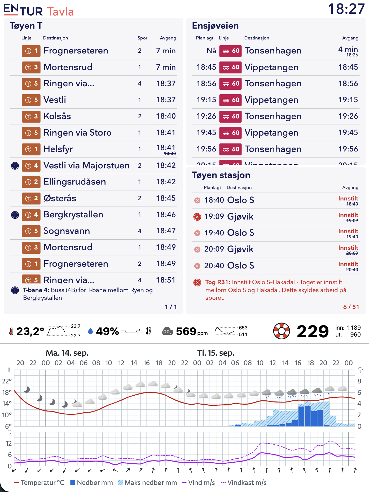

# Nettsida

Statussida som vises på hjemmeskjermen. Rendres by default i 1404×1872, som er formatet til e-paper-skjermen;



## Entur

Entur-dataen kommer fra en Entur-tavle rendret i en Iframe. Se [tavla.entur.no](https://tavla.entur.no) for mer info.

## YR

YR-dataen hentes ut som en widget, se [developer.yr.no/doc/guides/available-widgets](https://developer.yr.no/doc/guides/available-widgets).

## Tøyenbadet

Tall på hvor mange som er på Tøyenbadet ligger åpent tilgjengelig på denne siden: [web.datanova.com/OslobadeneERPTicketMonitor](https://web.datanova.com/OslobadeneERPTicketMonitor).

## Netatmo

Netatmo-dataen hentes via Netatmo sine API-er. Se [dev.netatmo.com/](https://dev.netatmo.com). Netatmo krever noe mer oppsett fordi det her er snakk om privat data (fra egen Netatmo) og man må legge inn sine egne secrets.

# Oppsett

Først trenger du Netatmo-credentials:
1. Logg inn på [dev.netatmo.com](https://dev.netatmo.com)
2. lag en app under **My Apps** (ved brukernavnet ditt i øvre høyre hjørne). Navn og URL spiller ingen rolle.
3. Noter deg Client ID og Client Secret i appen
4. Lag en .env-fil med følgende innhold:
```

VITE_ENTUR_TAVLA_URL=https://vis-tavla.entur.no/AHD7r0ucws4efJjl5eIm
VITE_YR_URL=https://www.yr.no/nb/innhold/10-996475/meteogram.svg

# Begge står på appsiden din på dev.netatmo.com
NETATMO_CLIENT_ID=<insert_netatmo_client_id her>
NETATMO_CLIENT_SECRET=<insert_netatmo_client_secret her>
```

Hvis du har flere Netatmo-moduler, kan du overstyre valget med `NETATMO_MODULE_ID=<mac-adresse>` i `.env`.

4. Kjør `pnpm netatmo-token`

5. Til slutt kan du kjøre nettsiden med

```sh
pnpm install
pnpm dev
```
